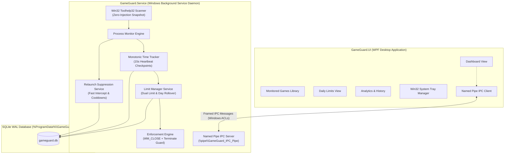

# GameGuard — Desktop Gaming Time Limiter & Enforcement System

[](https://dotnet.microsoft.com/)
[](https://microsoft.com/windows)
[](tests/GameGuard.Core.Tests/)
[](#anti-cheat-safety--compliance-statement)
[](#system-architecture)

**GameGuard** is a high-performance, offline-first Windows gaming time-management and automated limit enforcement suite built with **C#** and **.NET 10 LTS**. It combines a headless **Windows Background Service** daemon, a secure local **Named Pipes IPC** engine, and a dark-themed **WPF desktop application** to track active gaming sessions, enforce user-configured daily allowances, issue early warnings, and suppress unauthorized relaunches.

---

## Key Features

- **Anti-Cheat Safe Monitoring**: Uses non-intrusive Win32 Toolhelp32 process snapshots. GameGuard **never** reads/writes process memory, injects DLLs, installs hooks, or uses kernel drivers. Completely compliant with Riot Vanguard, Valve Anti-Cheat (VAC), Easy Anti-Cheat (EAC), and BattlEye.
- **Dual Limit Architecture**: Configure individual game limits (e.g., 60 minutes for *Counter-Strike 2*) alongside a shared daily gaming pool (e.g., 120 minutes total across all monitored games).
- **Grace Periods & Early Warnings**: Proactive desktop balloon toast notifications at 15m, 5m, and 1m remaining, followed by an adjustable grace countdown (e.g., 60 seconds) so players can save their game.
- **Safe Two-Phase Enforcement**: Issues graceful `WM_CLOSE` messages via `EnumWindows` first to allow standard game shutdown routines. Falls back to minimal-rights `SYNCHRONIZE | PROCESS_TERMINATE` only if the application hangs.
- **Instantaneous Relaunch Suppression**: Intercepts and terminates unauthorized game relaunches within 50ms while limits remain exhausted, with exponential cooldowns (3 attempts in 60s triggers a 5-minute cooldown).
- **PBKDF2 Admin Authentication & Overrides**: Secure parent/admin controls with salt + 100,000 iterations PBKDF2 hashing. Supports temporary bonus time (+15m, +30m, +1h), temporary unlock, and emergency lock.
- **Monotonic Clock & Anti-Tamper Defense**: Tracks gameplay using `Stopwatch.GetTimestamp()` immune to system clock shifts, detects OS sleep/hibernation gaps, and detects backward wall-clock tampering.
- **Dual-Mode Windows Daemon & Named Pipes IPC**: The headless Windows Background Service (`GameGuard.Service`) handles enforcement 24/7 in session 0. The desktop UI (`GameGuard.UI`) connects via secure Named Pipes (`\\.\pipe\GameGuard_IPC_Pipe`) with Windows ACLs, falling back gracefully to standalone in-process mode if the service is stopped.
- **Session Analytics & Tray Integration**: Today, 7-day, and 30-day playtime totals, interactive game distribution charts, detailed session history, and a native Win32 system tray icon.

---

## System Architecture



---

## Anti-Cheat Safety & Compliance Statement

GameGuard is strictly designed to coexist safely with intrusive anti-cheat systems (such as Riot Vanguard, Easy Anti-Cheat, BattlEye, and Valve Anti-Cheat):

| Vector | GameGuard Implementation | Anti-Cheat Compliance |
| :--- | :--- | :--- |
| **Memory Access** | **Zero memory reads or writes**. No `ReadProcessMemory` or `WriteProcessMemory`. | Safe |
| **Code Injection** | **Zero DLL injection**. No `CreateRemoteThread`, `SetWindowsHookEx`, or AppInit DLLs. | Safe |
| **Kernel Drivers** | **Zero drivers**. Runs purely in user space as a standard Windows service/app. | Safe |
| **Process Inspection** | Read-only Win32 Toolhelp32 snapshots (`CreateToolhelp32Snapshot(TH32CS_SNAPPROCESS)`). | Safe |
| **Process Termination** | Window message `WM_CLOSE` via `EnumWindows`, falling back to `PROCESS_TERMINATE`. | Safe |

---

## Solution Structure

```
├── GameGuard.slnx                     # .NET 10 Solution definition
├── src/
│   ├── GameGuard.Core/                # Domain abstractions, models, calculation logic, IPC contracts
│   │   ├── Models/                    # GameProfile, DailyLimit, GamingSession, AdminOverride, etc.
│   │   ├── Interfaces/                # Core repository, tracking, and enforcement interfaces
│   │   ├── Services/                  # LimitCalculator, SystemClock, MonotonicClock
│   │   └── Ipc/                       # IpcMessage, IpcContracts, IIpcServer, IIpcClient
│   ├── GameGuard.Infrastructure/      # Persistence, Win32 interop, monitoring, limits, IPC
│   │   ├── Persistence/               # SQLite WAL connection factory, repositories, database initializer
│   │   ├── Monitoring/                # Win32ProcessScanner (Toolhelp32), ProcessMonitor
│   │   ├── Tracking/                  # TimeTrackerService (Monotonic time tracking & recovery)
│   │   ├── Limits/                    # DayBoundaryCalculator, LimitManagerService
│   │   ├── Enforcement/               # Win32ProcessTerminator (WM_CLOSE + Terminate), EnforcementService
│   │   ├── Security/                  # RelaunchSuppressionService, SqliteAdminAuthService, ClockTamperDetector
│   │   ├── Analytics/                 # SessionAnalyticsService
│   │   ├── Notifications/             # SystemTrayManager (Win32 Shell_NotifyIcon), NotificationDispatcher
│   │   └── Ipc/                       # IpcMessageFramer, NamedPipeIpcServer, NamedPipeIpcClient
│   ├── GameGuard.Service/             # Headless Windows Background Service daemon
│   │   ├── GameGuardWorker.cs         # Background Worker lifecycle, monitoring loop & IPC server
│   │   └── Program.cs                 # CLI verb routing (--install, --uninstall, --start, --stop, --status)
│   └── GameGuard.UI/                  # WPF Desktop Application (MVVM, Dark Gamer Theme)
│       ├── ViewModels/                # MainViewModel, DashboardViewModel, GamesViewModel, LimitsViewModel, HistoryViewModel
│       ├── Views/                     # DashboardView, GamesView, LimitsView, HistoryView, SettingsView
│       ├── Styles/                    # Custom dark palette controls, templates, high-contrast ComboBoxes
│       └── App.xaml.cs                # Dual-mode DI bootstrapping (IPC client with standalone fallback)
├── tests/
│   └── GameGuard.Core.Tests/          # 128 xUnit unit, persistence, IPC, and end-to-end integration tests
└── scripts/
    ├── publish.ps1                    # Automated single-file win-x64 release compiler & packager
    ├── install-service.ps1            # Elevated Windows Service installer and storage ACL configurator
    └── uninstall-service.ps1          # Elevated Windows Service uninstaller
```

---

## Getting Started

### Prerequisites

- **Windows 10 / Windows 11 (64-bit)**
- **.NET 10 LTS SDK** (10.0.403+) installed at `$env:USERPROFILE\.dotnet` or in system `PATH`
- Administrator elevation required **only** when installing or uninstalling the Windows Background Service.

---

### Building and Testing

```powershell
# Ensure .NET 10 is in your PATH
$env:PATH = "$env:USERPROFILE\.dotnet;$env:PATH"

# Build entire solution
dotnet build GameGuard.slnx

# Execute all 128 automated unit, persistence, IPC, and E2E tests
dotnet test GameGuard.slnx
```

---

### Automated Production Release Packaging

Run the packaging script to verify tests and build self-contained, single-file win-x64 executables into `dist/`:

```powershell
powershell -ExecutionPolicy Bypass -File .\scripts\publish.ps1
```

**Generated Artifacts:**
- `dist/service/GameGuard.Service.exe`: Self-contained background service daemon (~73 MB)
- `dist/app/GameGuard.UI.exe`: Self-contained desktop application with system tray (~126 MB)

---

### Windows Service Management

The background service can be installed and managed either via the helper scripts or directly through the CLI:

#### Using Helper Scripts (Run Elevated as Administrator):
```powershell
# Install, configure %ProgramData%\GameGuard ACLs, and start the service
powershell -ExecutionPolicy Bypass -File .\scripts\install-service.ps1

# Stop and remove the service
powershell -ExecutionPolicy Bypass -File .\scripts\uninstall-service.ps1
```

#### Using the CLI directly:
```powershell
# Install Windows Service (auto-start on boot)
.\dist\service\GameGuard.Service.exe --install

# Start the service
.\dist\service\GameGuard.Service.exe --start

# Check service status
.\dist\service\GameGuard.Service.exe --status

# Stop the service
.\dist\service\GameGuard.Service.exe --stop

# Uninstall the service
.\dist\service\GameGuard.Service.exe --uninstall
```

---

## Resource Usage & Performance

| Metric | Background Service Daemon | Desktop UI Console |
| :--- | :--- | :--- |
| **Idle CPU** | $< 0.1\%$ | $0.0\%$ |
| **Active Scan CPU** | $< 0.5\%$ | $< 0.2\%$ |
| **Working Set Memory**| $22 - 35$ MB | $45 - 85$ MB |
| **Database I/O** | 15s WAL heartbeats | Read-only queries / IPC updates |

---

## Verification & Test Coverage

All 128 tests execute in ~1.0 second and pass with 0 failures:
- **Process Detection**: Toolhelp32 snapshot parsing, image path querying, process lifecycle diffing.
- **Time Tracking**: Monotonic clock precision, hibernation gap clamping, startup orphaned session recovery.
- **Limit Management**: Dual limit calculation, day rollover at midnight across local timezones, warning threshold dispatching.
- **Enforcement Engine**: Window closing, process termination, system PID protection (PID $\le 4$), PID reuse protection.
- **Security**: PBKDF2 salt hashing, clock tampering detection, relaunch suppression cooldown backoff.
- **IPC Protocol**: Length-prefixed framing, 1 MB payload limits, Named Pipes server/client roundtrip, broadcast streaming.
- **End-to-End**: Full lifecycle simulation from detection to limit exhaustion, enforcement, and relaunch suppression.

---

## License

This project is licensed under the MIT License.
